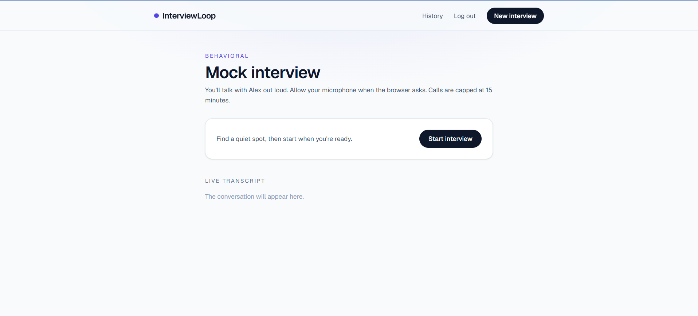
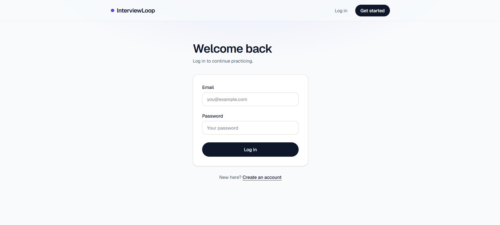
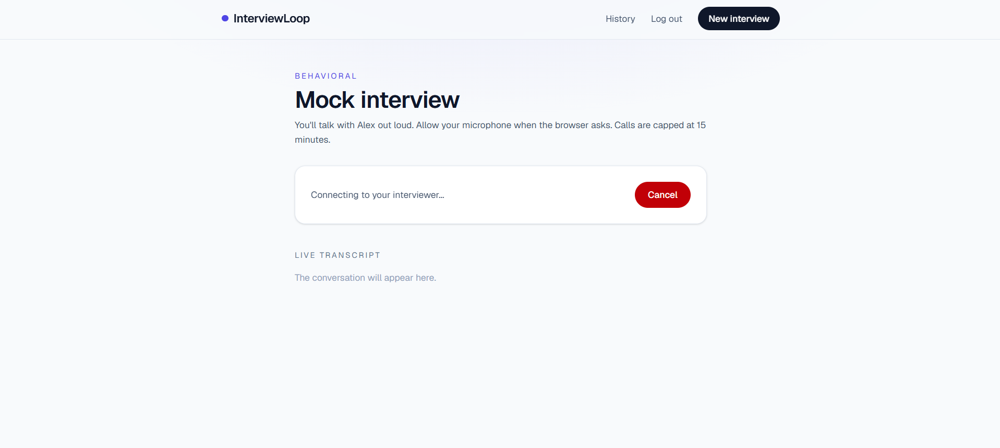
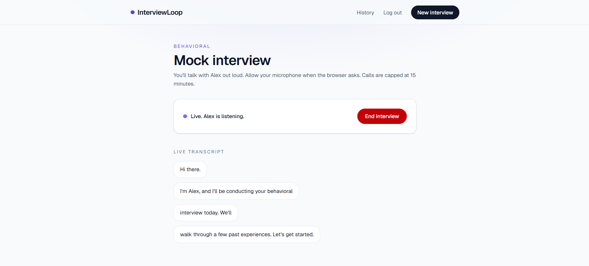
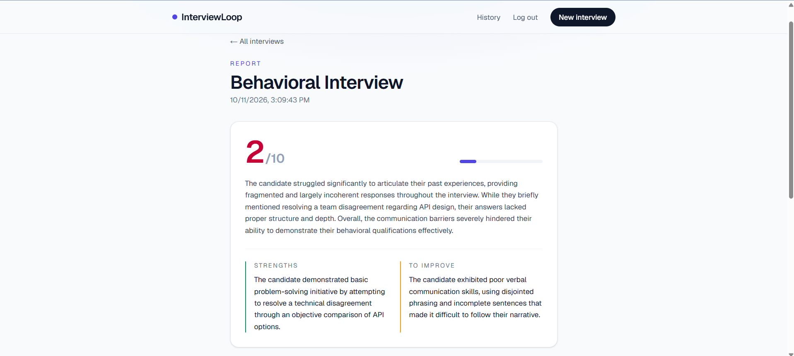
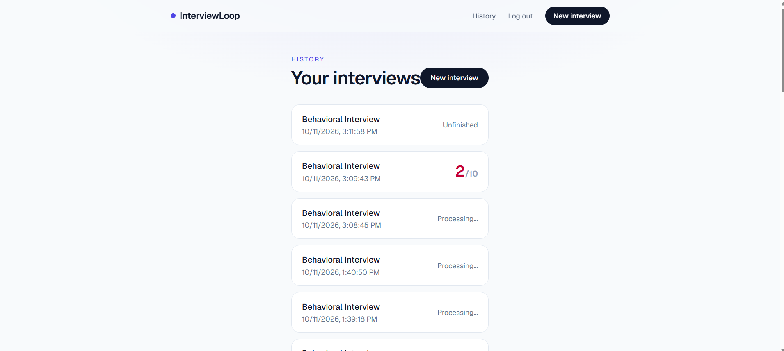

# InterviewLoop

Practice behavioral interviews out loud with a voice AI interviewer, then get a scored feedback report.

**Live demo:** https://interview-loop-one.vercel.app
**Demo video:** _add link here_

> Each account gets 3 practice interviews. A microphone is required.



## What it does

1. Sign up and log in.
2. Start an interview. Alex, a voice AI, asks behavioral questions and follows up when answers are vague.
3. The conversation is transcribed live on screen.
4. When the call ends, the full transcript is saved and an AI-generated report appears: a score out of 10, a short summary, strengths, and what to improve.
5. Past interviews, reports and transcripts live in a history page.

## Screenshots

### Log in



### Interview

| Ready to start | Live call with transcript |
|---|---|
|  |  |

### Report



### History



## How it works

```
Browser (Next.js)  ──start──▶  /api/sessions/start  ──▶  creates session row + Vapi assistant
      │                                                         │
      └──── voice call via Vapi Web SDK ◀───────────────────────┘
                                │
                  call ends     ▼
                  Vapi ──POST──▶ /api/webhook/vapi  (checks shared secret)
                                      │  saves transcript to Postgres
                                      │  sends transcript to Gemini
                                      ▼
                                 feedback row  ──▶  report page polls until it appears
```

A few design choices worth noting:

- **The transcript is saved server-side through a webhook**, not from the browser. The server gets Vapi's complete copy, and it still saves if the user closes the tab mid-call.
- **The webhook is protected with a shared secret** sent by Vapi in a header, and the session id travels in the webhook URL, so random requests can't write to someone's session.
- **Report generation runs after the webhook responds** (Next.js `after()`), with a per-attempt timeout and fallback across Gemini models, so a busy model doesn't hit the serverless time limit.
- **Interview limit per account** is enforced in a single SQL insert, so quick double clicks can't skip the cap.
- Sessions are scoped to the logged-in user in every API route.

## Tech stack

- **Frontend:** Next.js (App Router), React, Tailwind CSS
- **Backend:** Next.js API routes (serverless on Vercel)
- **Database:** PostgreSQL on Supabase, accessed with `pg`
- **Auth:** email and password with `bcryptjs` hashing and JWT
- **Voice:** Vapi (speech-to-text, LLM conversation, text-to-speech)
- **Feedback:** Google Gemini
- **Hosting:** Vercel

## Run it locally

You'll need accounts for Supabase, Vapi and Google AI Studio (Gemini).

```bash
git clone https://github.com/mru8/interview-loop.git
cd interview-loop
npm install
```

Create a `.env` file in the project root:

```
DATABASE_URL=            # Supabase Postgres connection string (pooler)
JWT_SECRET=              # long random string
VAPI_API_KEY=            # Vapi private key
VAPI_PUBLIC_KEY=         # Vapi public key
GEMINI_API_KEY=          # Google AI Studio key
WEBHOOK_SECRET=          # long random string, sent by Vapi to your webhook
NEXT_PUBLIC_BASE_URL=    # public URL of the app, no trailing slash
MAX_INTERVIEWS_PER_USER= # optional, defaults to 3
UNLIMITED_USER_IDS=      # optional, comma separated user ids with no limit
```

Passwords in the connection string must be URL-encoded if they contain special characters.

Create the tables (Supabase SQL editor):

```sql
create table users (
  id serial primary key,
  name varchar not null,
  email varchar not null unique,
  password_hash varchar not null,
  job_role varchar,
  experience_level varchar,
  created_at timestamp default now()
);

create table sessions (
  id serial primary key,
  user_id integer references users(id),
  interview_type varchar not null,
  status varchar,
  started_at timestamp default now(),
  ended_at timestamp
);

create table transcripts (
  id serial primary key,
  session_id integer references sessions(id),
  role varchar not null,
  message text not null,
  created_at timestamp default now()
);

create table feedback (
  id serial primary key,
  session_id integer references sessions(id),
  summary text,
  strengths text,
  weaknesses text,
  score integer,
  created_at timestamp default now()
);
```

Start the app:

```bash
npm run dev
```

Vapi has to reach your webhook, so for end-to-end testing locally you need a public URL for your machine (for example ngrok). Put that URL in `NEXT_PUBLIC_BASE_URL`. Without it the call works, but transcripts and reports won't be saved. Deploying to Vercel avoids this.

## Project structure

```
app/
  api/
    auth/login, auth/signup      account creation and login
    sessions/start               creates a session and the Vapi assistant
    sessions, sessions/[id]      history list and one session with transcript and report
    webhook/vapi                 receives the end-of-call report, saves data, triggers feedback
  interview/                     live call page
  dashboard/                     history and report pages
  login/, signup/
  components/Navbar.js
```

## Known limitations

- Needs a working microphone and a browser that allows mic access.
- Behavioral interviews only, in English.
- Calls are capped at 15 minutes.
- No email verification, so the per-account limit can be bypassed with new accounts.
- Very short interviews produce thin reports, and calls where the candidate says nothing produce none.
- Report quality depends on the Gemini model; the app falls back to other models if one is unavailable.

## Ideas for later

- Interview types beyond behavioral (technical, role-specific)
- Per-question feedback and an answer-structure check (for example STAR)
- Email verification and rate limiting
- Progress charts across sessions